# Unified ML Pipelines

Companion repository for two studies by Bhavin Kotak (`kotak.bhavin@gmail.com` | `bhavin.kotak@ibm.com`) on feature-store parity, content-hash artifact lineage, and fail-closed release gating across training and serving.



Interactive HTML version: [`docs/diagrams/unified-mlops-architecture.html`](./docs/diagrams/unified-mlops-architecture.html)

<!-- v2-release -->
## Version 2.0 study (November 2026)

Version 2.0 is a preregistered benchmark on public tabular datasets: *Unified ML Pipelines: A Reproducible Study of Training-Serving Skew, Lineage, and Release Gating* ([`v2/paper/main.pdf`](v2/paper/main.pdf)).

- Code, preregistration, logged runs, and tests: [`v2/`](v2/)
- Zenodo archive: [10.5281/zenodo.23970091](https://doi.org/10.5281/zenodo.23970091) (v1: [10.5281/zenodo.18445586](https://doi.org/10.5281/zenodo.18445586))
- Preregistered verdict: `SUPPORTED` (3 of 3 datasets)
- Key logged results: sharing one point-in-time feature definition across offline backfill (`70%` arrival split) and online serving (`30%` replay) raises online ROC-AUC over a dual batch/request implementation by `+0.086` on `adult` (95% CI `[0.063, 0.109]`), `+0.222` on `bank-marketing` (`[0.171, 0.274]`), and `+0.139` on `credit-g` (`[0.072, 0.205]`), with `0%` single-path skew when online reads complete. Content-hash lineage (`SHA-256` over data order, code, resolved parameters, environment, and fitted tree arrays) and a fail-closed CI gate (`AUC` margin `0.005` plus `<=1%` replay skew) block injected serving regressions before registry promotion.
- Reproduce everything: `python v2/code/run_all.py` and `pytest v2/tests/test_core.py -v`

Every number in the v2 paper comes directly from logged outputs in `v2/results/`. Unsupported v1 claims were removed and documented in [`v2/REVIEW.md`](v2/REVIEW.md).
<!-- v2-release -->

## Reference library (`src/`)

The `src/` package contains the v1 Python pipeline components (*Unified Machine Learning Pipeline Architecture for Enterprise-Scale Model Development and Deployment*): `FeatureStore`, `ModelRegistry` with stage transitions, `ExperimentTracker`, `MLPipeline`, and synthetic dataset generators.

## Project layout

```
unified-ml-pipelines/
├── docs/diagrams/              # Editorial architecture diagram (.html + .svg)
├── v2/
│   ├── code/umlp/              # Shared vs dual features, SHA-256 lineage, fail-closed CI gate
│   ├── code/run_all.py         # End-to-end v2 reproduction entrypoint
│   ├── paper/                  # LaTeX source and compiled main.pdf
│   ├── preregistration.json    # Locked hypothesis and decision rules
│   ├── results/                # Logged CSV/JSON outputs and verdict.json
│   └── tests/test_core.py      # Unit tests for skew, lineage, and gating
├── src/
│   ├── ml_pipeline.py          # FeatureStore, ModelRegistry, ExperimentTracker, MLPipeline
│   └── data_generators.py      # MLExperimentDataGenerator, FeatureDataGenerator
├── tests/test_ml_pipeline.py   # Unit tests for src/
└── requirements.txt
```

## Installation

```bash
python -m venv venv
source venv/bin/activate
pip install -r requirements.txt
```

## Quick start (`src/`)

### End-to-end pipeline

```python
from src.ml_pipeline import MLPipeline, MLPipelineConfig, TaskType
from src.data_generators import MLExperimentDataGenerator

data_gen = MLExperimentDataGenerator(random_seed=42)
df = data_gen.generate_classification_dataset(n_samples=2000)

config = MLPipelineConfig(
    experiment_name="fraud_detection",
    task_type=TaskType.CLASSIFICATION,
    random_seed=42
)

pipeline = MLPipeline(config)
pipeline.prepare_data(df, target_column='target')
results = pipeline.train_and_evaluate('random_forest')
print(f"Accuracy: {results['test_metrics']['accuracy']:.4f}")
```

### Feature store and model registry

```python
from src.ml_pipeline import FeatureStore, ModelRegistry, ModelStage

fs = FeatureStore("./my_features")
fs.register_feature("customer_age", "int", description="Customer age in years")
fs.register_feature("total_spend", "float", description="Total spending amount")
fs.ingest_features(df, ['customer_age', 'total_spend'])
features = fs.get_features(['customer_age', 'total_spend'], entity_ids=[1, 2, 3])

registry = ModelRegistry("./models")
model_id = registry.register_model(
    model=trained_model,
    model_name="fraud_detector",
    metrics={'accuracy': 0.95, 'f1': 0.92},
    parameters=trained_model.get_params(),
    feature_names=['age', 'amount', 'distance']
)
registry.transition_stage(model_id, ModelStage.PRODUCTION)
```

### Experiment tracker

```python
from src.ml_pipeline import ExperimentTracker

tracker = ExperimentTracker("my_experiment")
tracker.start_run("baseline_model")
tracker.log_params({'learning_rate': 0.01, 'batch_size': 32})
tracker.log_metric('accuracy', 0.95)
tracker.end_run()
best = tracker.get_best_run('accuracy', maximize=True)
```

## Running studies and tests

```bash
# Reproduce the v2 skew, lineage, and gating study
python v2/code/run_all.py
pytest v2/tests/test_core.py -v

# Run v1 demo and unit tests
python src/ml_pipeline.py
pytest tests/test_ml_pipeline.py -v
```

## Module map

| Capability | v2 study (`v2/code/umlp/`) | v1 library (`src/`) |
|------------|----------------------------|---------------------|
| Feature parity | Point-in-time single definition vs 5-source dual skew (`features.py`, `skew.py`) | `FeatureStore` (`ml_pipeline.py`) |
| Artifact lineage | Explicit vs resolved `SHA-256` data, code, env, and tree hashes (`lineage.py`) | `ExperimentTracker` (`ml_pipeline.py`) |
| Release gate | Fail-closed offline AUC + `<=1%` replay skew check (`gate.py`) | Stage transitions in `ModelRegistry` |
| Serving verification | `Registry.load` checks fitted `model_hash` before serving (`gate.py`) | `ModelRegistry.load_model` |

## License

MIT License.
